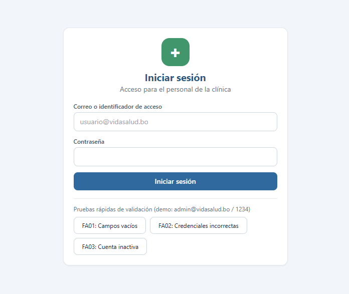
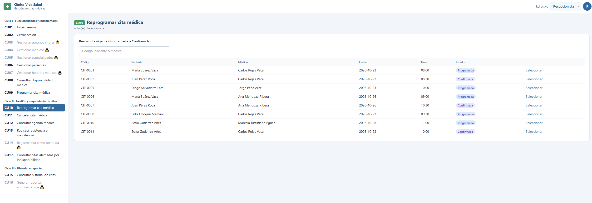
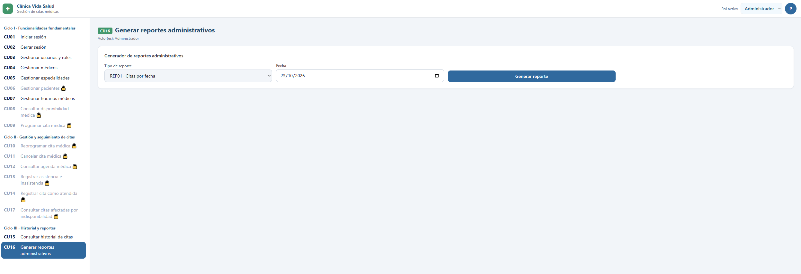

# Examen-Segundo-Parcial-INF-219
Clínica Vida Salud · Prototipo de interfaz de usuario

Prototipo web interactivo del Sistema Web para la Gestión de Citas Médicas para la Clínica Vida Salud. Documenta la sección de Prototipos de Interfaz de Usuario (metodología PUDS) y permite navegar las vistas de los 17 casos de uso (CU01–CU17), organizados en 3 ciclos de desarrollo.

Qué incluye
Selector de rol en la barra superior (Administrador, Recepcionista, Médico). El menú lateral bloquea las vistas no autorizadas según la regla RN12.
Datos de prueba en memoria: 4 especialidades, 5 médicos, 5 pacientes con CI boliviano, horarios de 30 minutos, indisponibilidades y citas en todos los estados.
Badges de estado por color: Programada (azul), Confirmada (índigo), Atendida (verde), Cancelada (rojo) e Inasistencia (ámbar).
Diseño adaptable (responsive), modales, validaciones y avisos en pantalla.
Casos de uso
Ciclo	Caso de uso	Actor
I	CU01 Iniciar sesión	Todos
I	CU02 Cerrar sesión	Todos
I	CU03 Gestionar usuarios y roles	Administrador
I	CU04 Gestionar médicos	Administrador
I	CU05 Gestionar especialidades	Administrador
I	CU06 Gestionar pacientes	Recepcionista
I	CU07 Gestionar horarios médicos	Administrador
I	CU08 Consultar disponibilidad médica	Recepcionista
I	CU09 Programar cita médica	Recepcionista
II	CU10 Reprogramar cita médica	Recepcionista
II	CU11 Cancelar cita médica	Recepcionista
II	CU12 Consultar agenda médica	Recepcionista y Médico
II	CU13 Registrar asistencia e inasistencia	Recepcionista
II	CU14 Registrar cita como atendida	Médico
II	CU17 Consultar citas afectadas por indisponibilidad médica	Recepcionista
III	CU15 Consultar historial de citas	Administrador y Recepcionista
III	CU16 Generar reportes administrativos (REP01–REP07)	Administrador
Fragmentos de código

Control de acceso por rol (RN12). Cada rol tiene su lista de vistas autorizadas; el menú lateral la usa para bloquear el resto.
```js
const ACC = {
  Administrador: ['CU01','CU02','CU03','CU04','CU05','CU07','CU15','CU16'],
  Recepcionista: ['CU01','CU02','CU06','CU08','CU09','CU10','CU11','CU12','CU13','CU15','CU17'],
  'Médico':      ['CU01','CU02','CU12','CU14']
};
```
Bloques horarios y disponibilidad. Los bloques se generan a partir del horario del médico. Cada uno se clasifica como Disponible, Ocupado por una cita o Bloqueado por indisponibilidad (CU08 y CU09).

```js
const slots = (m, f) =>
  H.filter(h => h.m == m && h.d == DIAS[new Date(f + 'T12:00').getDay()])
   .flatMap(h => {
     let r = [], t = h.i;
     while (add(t, h.dur) <= h.f) { r.push(t); t = add(t, h.dur); }
     return r;
   });
```
```js
const sl = (m, f, t, ex) => {
  let x = X.find(x => x.m == m && f + ' ' + t >= x.i && f + ' ' + t < x.f);
  if (x) return ['Bloqueado', x.mot];
  let c = C.find(c => c.m == m && c.f == f && c.i == t && vg(c) && c.c != ex);
  return c ? ['Ocupado', c.c] : ['Disponible', ''];
};
```
Citas afectadas por indisponibilidad (CU07 y CU17). Una cita vigente queda afectada si se superpone con una ausencia, permiso o vacación del médico.

```js
const ov = (c, x) =>
  c.m == x.m && c.f + ' ' + c.i < x.f && c.f + ' ' + add(c.i, 30) > x.i;
Capturas de pantalla
```
md
### Ciclo I


### Ciclo II


### Ciclo III


Cómo ejecutarlo
Descarga o clona el repositorio.
Abre index.html en el navegador.
Cambia el rol desde la barra superior y recorre los casos de uso desde el menú lateral.
